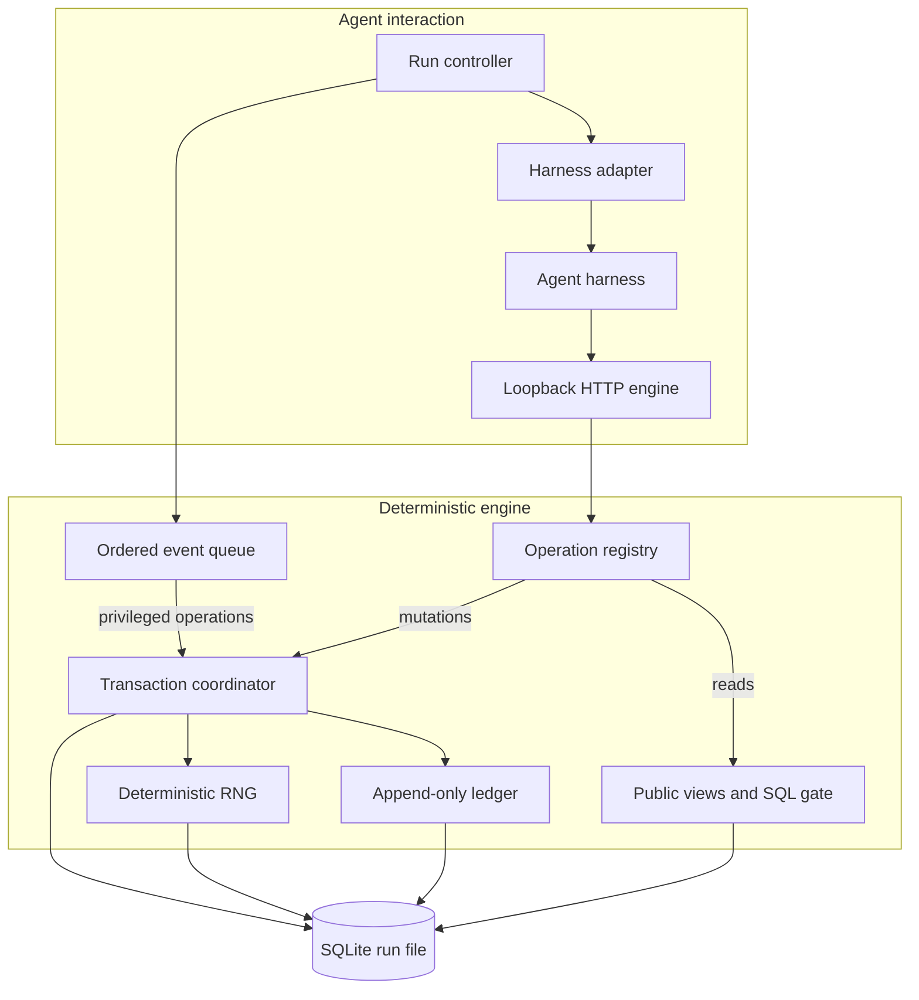

# Trades Bench

*How good are LLMs at running a simulated home-services business?*

[Quick start](#quick-start) • [Architecture](#architecture) • [Development](#development)

Trades Bench is a Python simulation engine for evaluating how AI agents operate a
Phoenix-area HVAC, plumbing, and electrical home-services company. Agents handle structured
customer calls, maintain customer records, book work, and dispatch technicians while
the engine advances weather, demand, travel, job outcomes, and company finances.

The simulation is built for exact replay: the same seed and agent actions produce the
same world state, including after resuming from a copied SQLite run file.

> [!IMPORTANT]
> This repository currently provides the simulation engine and its loopback HTTP
> operation surface. The packaged agent SDK and CLI, benchmark harness, and calibrated
> scoring baselines aren't included yet.

## Quick start

## Usage

Until the agent SDK and CLI land, use the engine modules directly. These foundational
primitives are enough to inspect the time and money logic:

```python
from trades_bench.clock import Clock, phoenix_instant
from trades_bench.money import Money

start = phoenix_instant(2026, 10, 1, 6, 45)
clock = Clock(start)

print(clock.now_iso())
print(Money(10_000) + Money(2_345))
```

```text
2026-10-01T06:45:00-07:00
$123.45
```

A complete run follows this lifecycle:

1. Load and validate a `RunConfig` with `trades_bench.config.load_run_config`.
2. Create the SQLite run file with `trades_bench.run_init.initialize_run` and a
  verified geography artifact.
3. Connect a `HarnessAdapter` implementation to `trades_bench.controller.Controller`.
4. Advance the event loop with `Controller.step()` or `Controller.run()`.
5. Compare runs with the canonical hash from `trades_bench._dump.dump_hash`.

The checked-in default configuration runs from October 1 through October 14, 2026,
in the `America/Phoenix` timezone. It uses ten service zones and six daily service
blocks, including one after-hours block.

## Architecture




## Configuration

`load_run_config()` combines packaged defaults with an optional scenario overlay. It
validates the complete key set, protects simulation constants, freezes values, and
exposes configuration bytes and a hash.

```python
from trades_bench.config import load_run_config

config = load_run_config(
    scenario_json='{"keys":{"run.end_date":"2026-10-03"}}'
)

print(config.get_string("run.end_date"))
print(config.config_hash)
```

Provisional values awaiting calibration are recorded in
`src/trades_bench/deferred_manifest.json`.

## Development

Run the standard checks:

```bash
uv run pytest -q
uv run ruff check .
```

Rebuilding and validating the geography artifact uses a separate dependency group and
requires a running Docker daemon:

```bash
uv sync --group geo
uv run --group geo pytest -m docker -q
```

The runtime geography artifact is pinned by ID and SHA-256. Its source attribution and
license are included under `data/geography-arizona-v1/`.